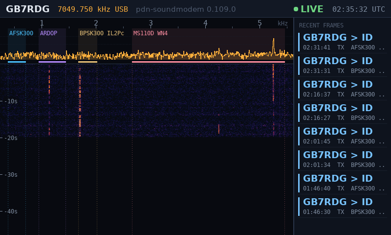
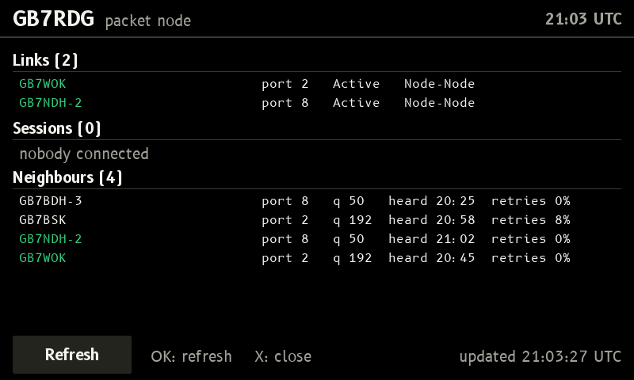
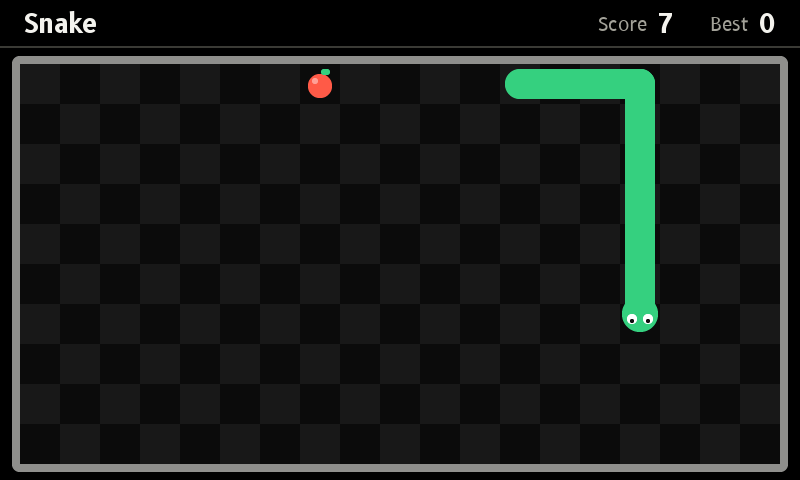
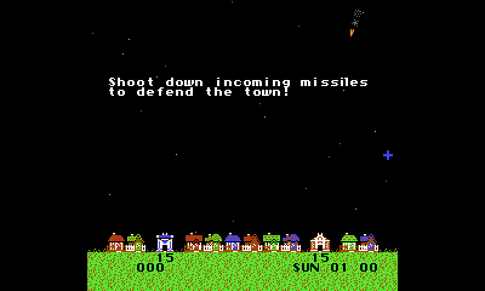

# yealink-t48s-apps

Apps for the open firmware for the Yealink SIP-T48S desk phone: [M0LTE/yealink-t48s](https://github.com/M0LTE/yealink-t48s). How apps fit in: [docs/architecture.md](https://github.com/M0LTE/yealink-t48s/blob/main/docs/architecture.md#3-apps) in the firmware repo.

| App | What it does |
|---|---|
| [hello](apps/hello) | The smallest useful app. Copy it to start your own. |
| [waterfall](apps/waterfall) | Live receive waterfall and recent frames of a pdn-soundmodem station (GB7RDG unless you change its address). Tap a frame for its details. |
| [links](apps/links) | A LinBPQ packet node at a glance: open links, sessions and neighbours (GB7RDG unless you change its address). |
| [snake](apps/snake) | The classic game: eat apples, grow, get faster. Keys or touch. |
| [nes](apps/nes) | Plays NES games, with sound. Two free ones come with it; more load from the data folder or a USB stick. |
| [demo](apps/demo) | Real-time 3D, a tunnel, plasma and a scroller, in the old demo style, with a chiptune made as it plays: what the phone can draw and play. |







## The feed

Every push to `main` builds the apps and publishes them at **https://m0lte.github.io/yealink-t48s-apps/**: `index.json` there is the phone's default app feed, with a `.t48app` package for each app beside it and a page for people. The format is in the SDK's README ([sdk/README.md](https://github.com/M0LTE/yealink-t48s/blob/main/sdk/README.md#packages-and-feeds) in the firmware repo).

## Writing an app

An app is a folder: a `manifest.json`, a 96 x 96 icon (`icon.ppm`, binary PPM) and one static ARM program that talks to the phone's shell over a socket. The shell gives it a screen buffer to draw in, and sends it keys, touches, its settings, and "you are paused" when the owner goes Home or a call comes in. [docs/app-protocol.md](https://github.com/M0LTE/yealink-t48s/blob/main/docs/app-protocol.md) is the full contract, including the manifest.

**1. Get the SDK** (x86-64 Linux; needs `make`, a C compiler and python3):

```
curl -fsSLO https://github.com/M0LTE/yealink-t48s/releases/download/sdk-latest/t48s-sdk.tar.gz
tar -xzf t48s-sdk.tar.gz && t48s-sdk/relocate-sdk.sh
export T48_SDK=$PWD/t48s-sdk
```

**2. Copy hello.** `cp -r apps/hello apps/myapp`, then in the copy rename `hello.c`, set `APP` and `SRC` in the `Makefile`, and give `manifest.json` your app's `id` (the same as `APP`), `name`, `version`, `description` and settings. The `id` is a-z, 0-9, `-`, `.` and `_`.

**3. Write it** with libt48. `$T48_SDK/share/t48/libt48/include/t48.h` lists everything: drawing, fonts, a JSON reader, a WebSocket client, timers, watching your own sockets, settings. [hello.c](apps/hello/hello.c) shows the shape of an app: start, draw, then a loop over events. Take colours from `t48_theme_now()` (ground, ink, quiet ink, go, stop) and draw everything again on `T48_EV_THEME`, and the app wears whichever theme the owner picked in Settings, Screen, Theme; the fonts follow by themselves, and `t48_ui_*` draws the shell's own header, buttons and rows. Answer PAUSE by closing network connections (the app is frozen a second later) and RESUME by drawing everything again. A short press of X is "back"; leave with `return 0` when there is nowhere to go back to.

**4. Build and try it on this PC:**

```
cd apps/myapp
make            # build/arm/myapp for the phone, build/host/myapp for the simulator
make shot       # start it in the simulator, picture in build/shot.png
make check      # run tests/*.script in the simulator
```

The simulator is the real shell with the screen kept in memory; a script presses keys, touches the screen and takes pictures (commands in [docs/shell.md](https://github.com/M0LTE/yealink-t48s/blob/main/docs/shell.md#the-simulator)). `tests/APP.conf` holds `key=value` settings for the tests. Put the pictures you want people to see in `screenshots/`.

**5. Put it on a phone** running the firmware, over SSH:

```
make package    # build/myapp-0.1.0.t48app
ssh root@PHONE 'tar -C /data/apps -xzf -' < build/myapp-0.1.0.t48app
```

It appears in the launcher. Settings go in `/data/config/apps/myapp.conf` as `key=value` lines until the phone has settings screens.

**6. Get it into the feed:** a pull request adding `apps/myapp`. CI builds every app, runs its simulator tests and, once merged, publishes it.

**Other languages:** anything that becomes one static ARMv6 Linux program (soft-float, no shared libraries) and speaks the protocol is an app. The protocol is a few little-endian messages on a socket and a shared memory buffer. The SDK's cross compiler and musl are there for C; Rust (`arm-unknown-linux-musleabi`), Zig or Go (`GOARCH=arm GOARM=6`) can target the phone directly. `$T48_SDK/bin/t48-pack FOLDER OUTDIR` packages any app folder.

## Icons

`tools/make-icons.py` draws the apps' icons (needs python3-pil and the DejaVu fonts). Any 96 x 96 binary PPM will do.

## Licence

AGPL-3.0-or-later (see `LICENSE`). libt48, which every app links, is AGPL-3.0-or-later too, so apps built with it are as well.

What a published package contains besides this repository's code, all linked into the one program: libt48 with glyphs of its fonts (B612, IBM Plex and Figtree, SIL Open Font Licence 1.1), musl (MIT) and GCC's runtime library (GPL-3.0-or-later with the GCC Runtime Library Exception). The icons are drawn with DejaVu fonts (Bitstream Vera licence). The nes package also carries two homebrew games by Damian Yerrick, Thwaite and Concentration Room, each GPL-3.0-or-later and shipped unchanged as separate works, with their source kept beside them: [apps/nes/roms](apps/nes/roms/README.md). Licence texts, and the source for the SDK's compiler: [NOTICE.md](https://github.com/M0LTE/yealink-t48s/blob/main/NOTICE.md) in the firmware repo.

## Notice

Not affiliated with or endorsed by Yealink. Yealink is a trademark of its owner. Use at your own risk.
