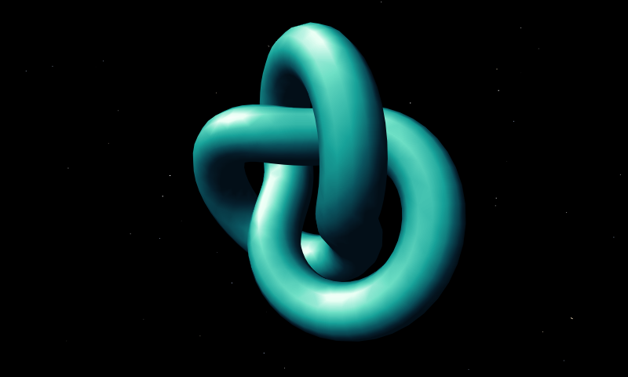
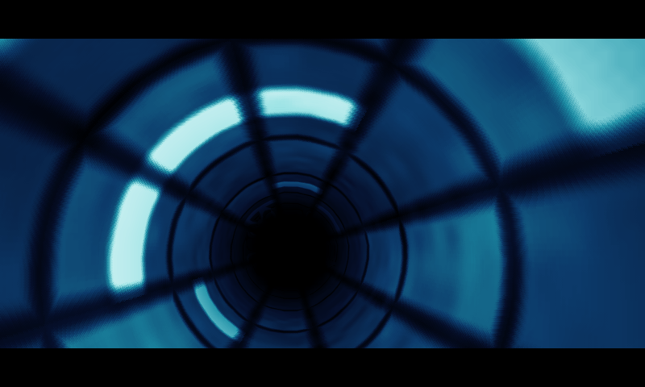

# Demo

Real-time graphics on a desk phone, in the old demo style: a loop of about two and a half minutes, drawn by a 500 MHz ARM1176 with no GPU and no usable FPU. Issue [#13](https://github.com/M0LTE/yealink-t48s-apps/issues/13).

| Key | |
|---|---|
| `*` | show or hide the frame rate |
| left, right | previous, next part |
| anything else, or a touch | leave |





## The parts

| Part | What it shows |
|---|---|
| stars | a starfield with sub-pixel stars that streak at speed, and three title cards |
| gem | a flat-shaded solid lit by two lamps, every edge smoothed |
| plasma | five sines through a turning palette, worked out on a grid and stepped between |
| knot | a Gouraud-shaded torus knot of 3584 triangles |
| roto | a rotozoomer |
| tunnel | a textured tunnel with the eye free to look about, lit from ahead |
| outro | a mirror (environment-mapped) torus over a sine scroller |

## What the phone manages

The screen refreshes 67.8 times a second, so a part runs at 67.8 frames a second or at 33.9. Writing memory is the limit: about 160 MB a second, so filling 800 x 480 once takes 10 of the 14.7 ms in a refresh. Draw times on the phone (`make bench`, 2026-11-25):

| Part | Drawn at | Draw time | Pace it is set for |
|---|---|---|---|
| stars | 800 x 480, only what moves | 4.1 ms | 67.8 |
| gem | 800 x 480, only what moves | 9.4 ms | 67.8 |
| plasma | 800 x 384 | 8.7 ms | 67.8 |
| knot | 800 x 480, only what moves | 19.1 ms | 33.9 |
| roto | 400 x 192, doubled | 10.8 ms | 67.8 |
| tunnel | 800 x 384 | 22.8 ms | 33.9 |
| outro | 800 x 480, only what moves | 23.4 ms | 33.9 |

The paces are what the draw times allow with flipping; they have not yet been watched on the glass, as the phone's firmware was still at level 2 when this was measured. Run through the level 2 fallback on the phone, an earlier build gave 60 (stars), 51 (gem), 53 (plasma), 38 (knot), 51 (roto), 45 (tunnel, then at half size) and 32 (outro) frames a second, with tearing.

## How it is drawn

- **Fixed point everywhere.** Floats are used only to make tables at start.
- **Solids** (`r3d.c`): screen positions carry four bits below the pixel and every edge is stepped from where it really starts, so a slow turn glides instead of snapping. Shading is a plane over each triangle evaluated at pixel centres. Triangles are sorted far to near. After each is filled, its outline edges get one more row of pixels mixed in by coverage, which is what smooths the silhouette.
- **Only what changed is redrawn.** The sky is black, so a solid part clears the box its solid covered last time in this buffer, rubs out last time's stars, and draws both again: a fraction of the screen.
- **Plasma, rotozoomer and tunnel** (`fx.c`) are one renderer: the effect is worked out exactly at the corners of 16 x 16 cells and stepped in straight lines between, cell by cell so texture reads stay in the cache.
- **The scroller** takes each screen column from a strip of text made once from the phone's own font, moved by a sine with sub-pixel mixing in y. It moves a whole number of pixels each refresh.

## Frames and time

`fe.c` is the only file that knows how a frame reaches the glass. With firmware API level 3 it draws into the shell's flip buffers and each frame is shown whole at a refresh of the screen (67.8 a second on the T48S): no tearing, no copy. On older firmware it falls back to the shared buffer and DAMAGE, which tears.

Each part asks for a pace: every refresh, or every second one. A part that cannot keep its pace is stepped down for the rest of its run, as an even 34 frames a second looks better than an uneven 50.

The timeline (`demo.c`) is laid out in bars at 125 beats a minute, and parts are told the beat. There is no sound yet, as apps cannot play audio. When they can, the clock becomes the audio stream's position and a tune drops onto the same bars.

## Working on it

```
make check                     # the simulator steps through every part
make bench                     # build/arm/demo-bench: draw times without a shell; run it on the phone
DEMO_AT=47000 make shot        # a picture from 47 s into the loop
DEMO_DRAW_MS=20 ...            # every frame takes at least this long to draw: for trying the pacing
```

With the overlay on, each part's frame rate and draw time are also written to `fps.log` in the app's data folder when the part ends.
