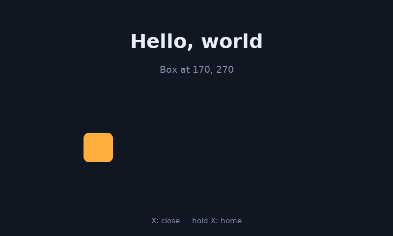

# Hello

The smallest useful app: it greets whoever its `name` setting names, moves a box with the arrows or a touch, and closes on X. Copy this folder to start a new app; the guide is in the [top README](../../README.md#writing-an-app).

