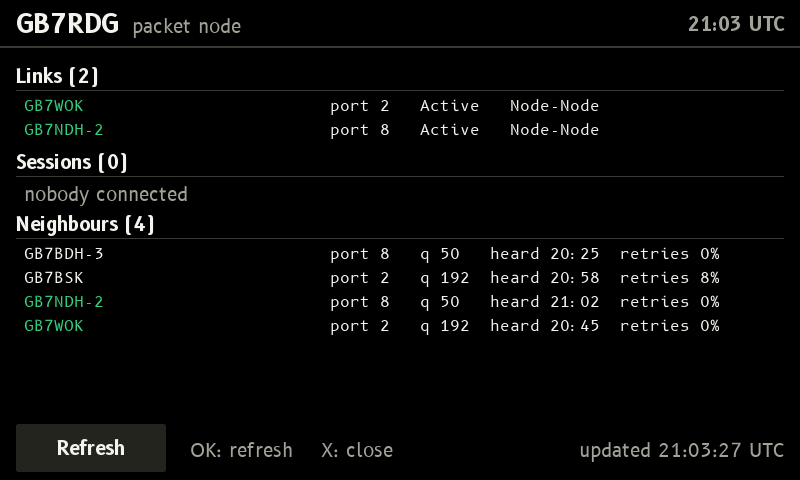
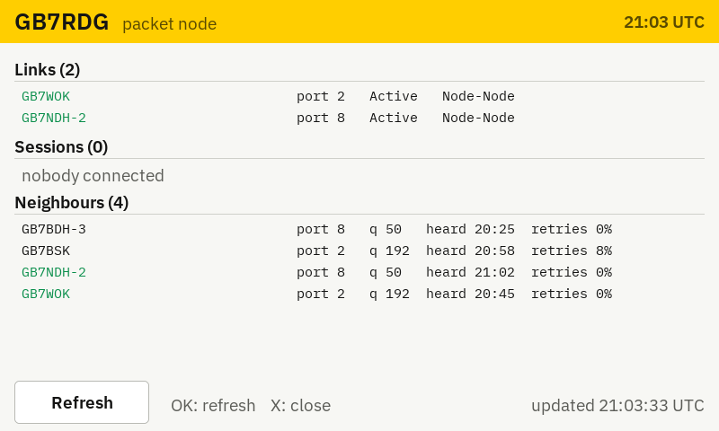
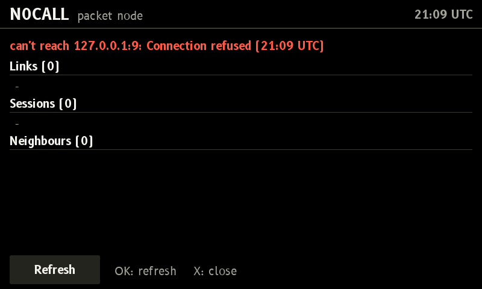

# Node links

A LinBPQ packet node at a glance: open AX.25 links, who is connected, and the neighbours with their quality, last heard time and retries. It reads the node's own web server (`/Node/Links.html`, `Users.html`, `Routes.html`) every 15 seconds while it is on the screen, and not at all while it is not.

| Setting | Default | |
|---|---|---|
| `url` | `http://10.45.0.121:8008/` | the node's web server (GB7RDG) |
| `name` | `GB7RDG` | the node's callsign, shown at the top |

OK or Refresh reads the node at once. X closes the app.

It wears the owner's theme: the shell's own header and button, and the theme's colours and fonts.

Moved from the firmware repo's `native/t48ui.c`, the GB7RDG links screen that ran beside Yealink's own phone software.
