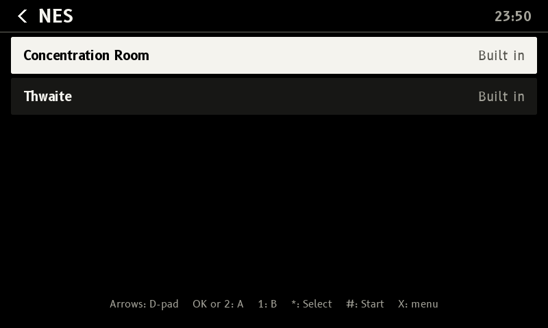
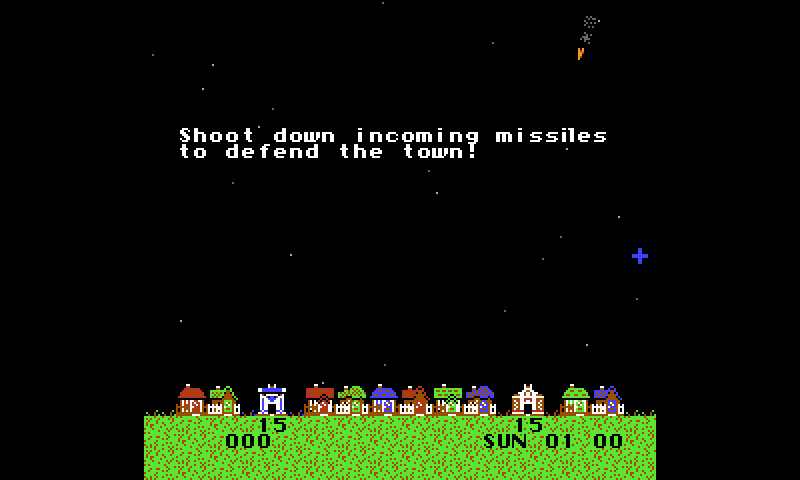
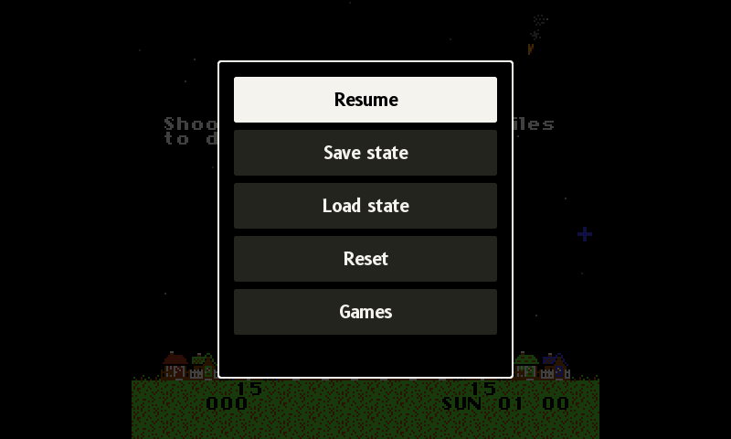

# NES

Plays NES games on the phone. Two come with it; more load from the phone's data folder or a USB stick.





## Keys

| Key | Pad |
|---|---|
| Arrows | D-pad |
| OK or 2 | A |
| 1 | B |
| * | Select |
| # | Start |
| X, or a touch | Menu: resume, save state, load state, reset, games |

Keys can be held and pressed together, as on a pad. A long press on X is still Home; the game stops behind its menu and is there when you come back.

## Your own games

`.nes` files are found in:

- the app's data folder, `/data/appdata/nes` or `roms/` inside it (copy them over SSH);
- any USB disk the phone has mounted: its top folder, `nes/` or `roms/`.

The list looks again every two seconds, so a stick shows up by itself. The firmware does not mount a stick on its own yet, so for now the data folder is the way in.

Supported boards: NROM, MMC1, UxROM, CNROM, MMC3, AxROM, Color Dreams, BNROM, GxROM and Camerica (mappers 0, 1, 2, 3, 4, 7, 11, 34, 66, 71). Anything else is refused by name: `Mapper 5 not supported`.

## Saves

In the data folder, named after the ROM and its checksum, so two different ROMs of one name do not share a save: `Game.1a2b3c4d.sav` is the cartridge's battery memory (8 KB, as other emulators keep it), written when the menu opens and when the game is left; `Game.1a2b3c4d.state` is the one saved state, written by Save state.

## What it does not do yet

- Sound. Apps cannot play audio yet. The APU's timing is all there (frame counter, length counters, DMC, their IRQs) because games depend on it; the two places where the sound itself goes are marked in `apu.c`.
- A second pad, the Zapper, PAL timing, the Famicom Disk System.
- Tear-free pictures on a level 2 firmware. Built against a level 3 libt48, `video.c` flips whole pictures instead (and still copies on an older shell); that path passes both test scripts in the level 3 simulator and has not yet run on a phone.

## Speed

Measured on a T48S (ARM1176, 500 MHz), 2026-11-25:

| | |
|---|---|
| the core alone, no picture | 2.3 ms a frame (about 430 a second) |
| with every line doubled into memory | 9.4 ms a frame (about 105 a second) |
| the app on a level 2 shell, Thwaite | 60 a second; 4 in 100 pictures left out |
| the app on a level 2 shell, a full-screen scroll | 60 a second; 5 in 100 pictures left out |

The game always runs at the NES's own 60.1 frames a second from the clock. When the phone falls behind, pictures are left out (never more than three in a row), not time. On this PC the core runs at about 13000 frames a second.

## How it is made

The core is written for this app: `cpu.c` (the 6502, unofficial opcodes included), `ppu.c` (the picture, a scanline at a time), `apu.c`, `cart.c` (the boards) and `nes.c` (the machine and save states). It does not know about the phone. `main.c` is the list, the menu and the keys; `video.c` puts the picture on the screen; `scale.h` doubles each line straight from the palette into the screen buffer and leaves out lines that have not changed, because on this phone writing a megabyte of pixels costs more than emulating the frame.

Drawing a scanline at a time from the scroll registers as they stand at its start is what makes it fast. It is right for games that change scrolling between lines (status bars, split screens, MMC3's line counter) and wrong for the few that change it in the middle of a line.

`make nesrun` builds the core without the phone, for this PC and for ARM:

```
build/nesrun game.nes -f 3000            # frames a second, drawing every line
build/nesrun game.nes -f 3000 -c         # leaving out unchanged lines, as the app does
build/nesrun nestest.nes -t nestest.log  # compare every instruction with nestest's log
build/nesrun test.nes -b                 # run one of blargg's test ROMs and print its verdict
```

What passes: nestest (all 8991 instructions, cycle counts included), blargg's `official_only`, `cpu_timing_test6`, the three branch timing tests, `cli_latency`, sprite hit 1 to 11, sprite overflow basics, `mmc3_test_2` 1, 2, 3 and 5, APU 1, 2, 3, 5, 7 and 8, `vbl_basics` and `nmi_control`, and Holy Mapperel's board checks for every mapper above. What does not: tests that need timing finer than an instruction (the exact dot the vertical blank flag rises, IRQ jitter, sprite overflow's hardware bug). The test ROMs are not kept here.

## Licence

The app is AGPL-3.0-or-later like the rest of this repository; the core was written fresh, with no third-party emulator code. The two games are separate works under their own licences: [roms/README.md](roms/README.md).

NES and Nintendo Entertainment System are trademarks of Nintendo. This is not affiliated with or endorsed by Nintendo.
