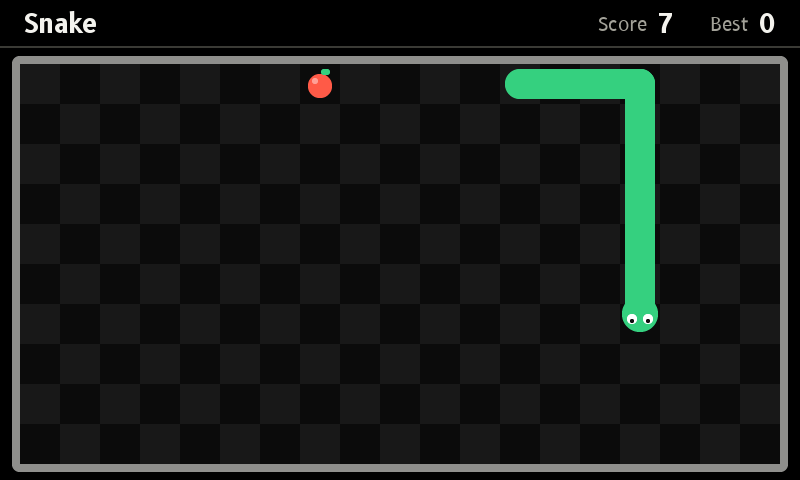
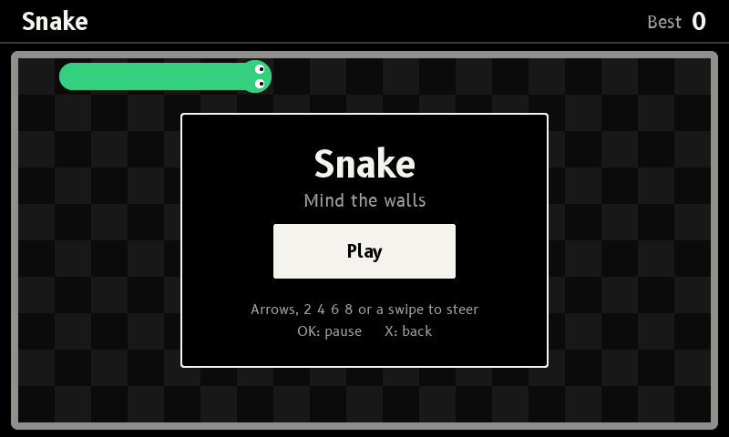
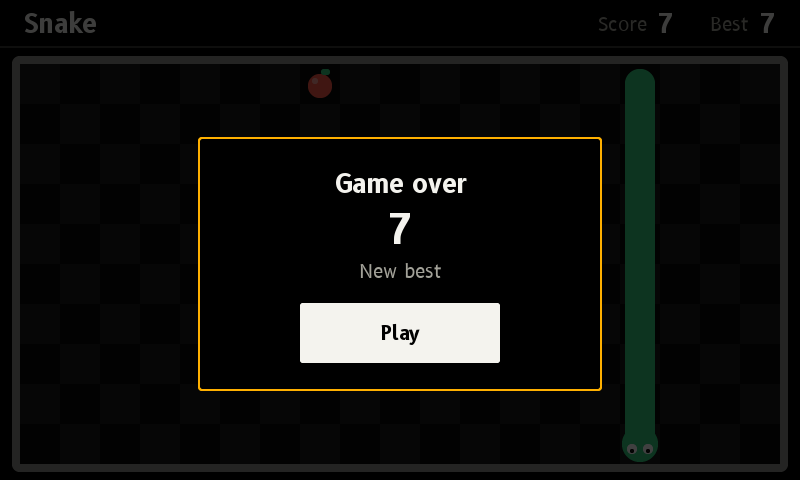
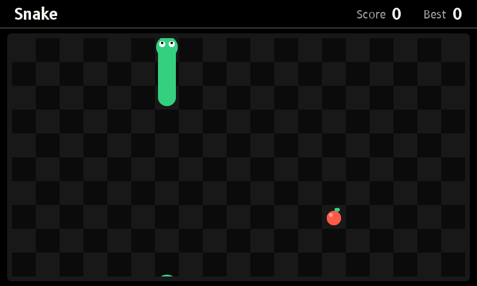
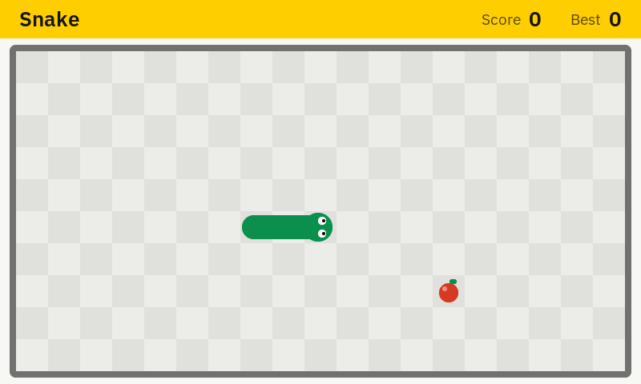
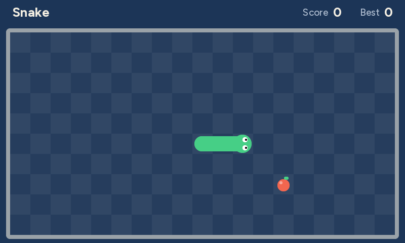

# Snake

The classic. Eat apples, grow, and do not run into yourself or the wall. Each apple makes the snake a little faster. The best score is kept.

| | |
|---|---|
| Steer | The arrows, or 2 4 6 8, or a swipe, or a tap to one side of the head |
| Pause | OK |
| Back | X |

`walls` (App settings, Walls) is on to start with. Off, the snake leaves one edge and comes back in at the opposite one, and that game has a best score of its own.

A few short sounds, made as they play: a blip for each apple that climbs as the snake grows, a tick for a turn, a thud for a crash and a few notes for a new best. The volume keys set how loud. On firmware from before apps had sound (API level 4) the game is the same, silent.

## How it is made

libt48, API level 2: `snake.c` is the game and `sfx.c` its sounds (`make wav` writes them all to `build/snake.wav`). The game moves a cell at a time; the picture slides the head and the tail between cells 30 times a second, repainting only the parts that changed. Every rectangle is finished off screen and then copied, so nothing half drawn is shown; `present()` is the one place that would change for a full-screen, double-buffered mode.

The best scores are in `best` in the app's data folder.

## Tests

`make check` plays three scripted games in the simulator: a whole game with walls by the keys, one without walls by touch, and one that changes theme on the way. They put a file named `test` in the data folder (`seed N`, `step MS`) so the apples appear in the same places at a fixed speed, and wait for the head to reach a cell before each turn.
