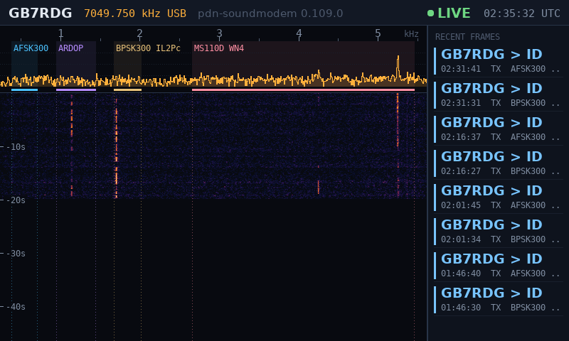
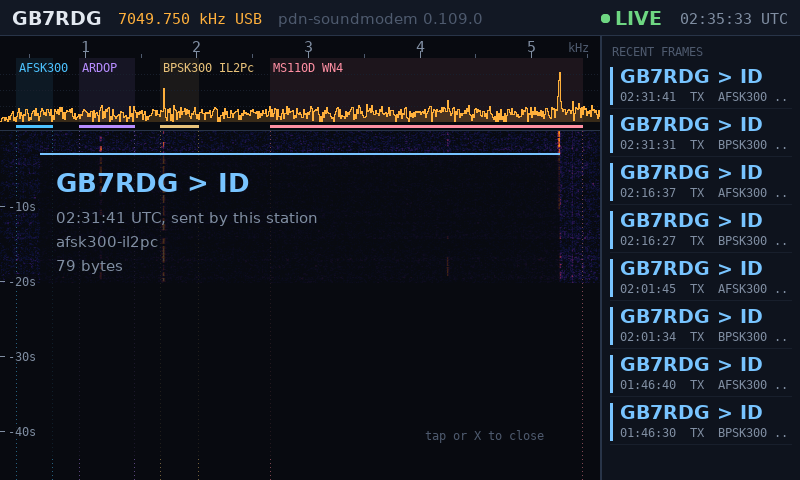
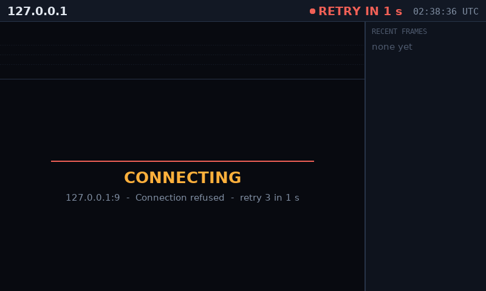

# Waterfall

Live receive waterfall of a [pdn-soundmodem](https://github.com/M0LTE/pdn-soundmodem) station: frequency scale, live spectrum, the modem bands, decoded frames tagged on their bursts with callsign and SNR, and a list of recent frames. Tap a frame in the list for its details. It only listens: it answers the station page's keep-alive and nothing else, and never sends anything that could key a transmitter. It lets go of the station while it is off the screen and reconnects when it is back.

| Setting | Default | |
|---|---|---|
| `url` | `ws://10.45.0.37:8099/` | the station page's address (GB7RDG) |
| `name` | empty | the name in the header; empty: the station's own title, else GB7RDG for the default address, else the host |

OK tries again at once while it cannot connect. X closes the details, then the app.

Moved from the firmware repo's `native/waterfall.c` (M0LTE/yealink-t48s#13). Protocol and design follow M0LTE/esp32-knob-pages; `wf_fold.c` is adapted from it.
